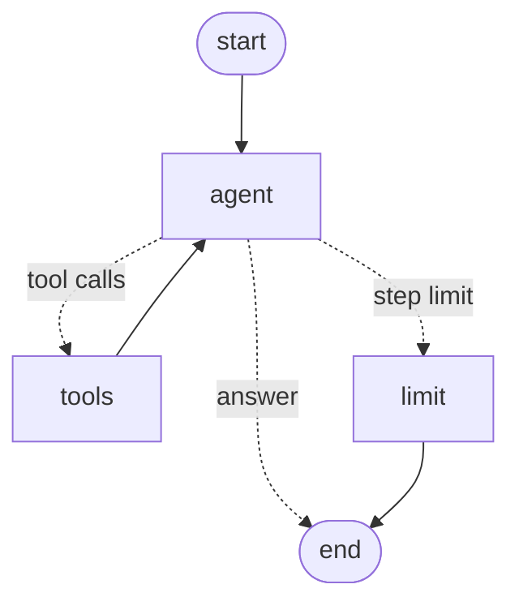

# cricket-ai

An end-to-end applied AI portfolio built on cricket: ball-by-ball analytics and win probability,
synthetic data generation, computer vision on match footage, multimodal RAG and an agent that
orchestrates all of it, each module containerised and deployable to Kubernetes on AWS.

Core models (the GAN, the shot classifier and the win-probability model) are hand-written in
plain PyTorch; libraries such as Ultralytics, Hugging Face and CTGAN are used as baselines and
building blocks around them.

## Modules

| # | Module | What it shows | Status |
|---|--------|---------------|--------|
| 1 | Data pipeline, analytics, win probability | Data engineering, validation, tabular modelling, calibration | 🟡 Pipeline and model code done |
| 2 | Synthetic data (GAN, CTGAN) | Generative modelling, fidelity / utility / privacy evaluation | ✅ GAN beats CTGAN library on 4 of 5 metrics |
| 3 | Video and image analysis | YOLO detection, ball tracking, pose-based shot classification | ⚪ Planned |
| 4 | Multimodal RAG | Hybrid retrieval, SQL for numbers, citations, image search, evals | 🟡 Code done, IPL run next |
| 5 | LangGraph agent | Tool orchestration across modules 1, 2 and 4, with approval and tracing | 🟡 Code done, LLM run next |
| 6 | Docker, Kubernetes, AWS | kind locally, short EKS deployment, S3/ECR | 🟡 Data image done |

Full task breakdown: [TRACKER.md](TRACKER.md).

## Quickstart

```bash
python -m venv .venv && source .venv/bin/activate
pip install -e ".[dev]"

cricket-ai data download ipl      # Cricsheet IPL archive -> data/raw/ipl
cricket-ai data build ipl         # validated Parquet tables -> data/processed/ipl
cricket-ai data features ipl      # win-probability chase states
cricket-ai data report ipl        # batting / bowling / phase / team summaries -> reports/ipl

pip install -e ".[winprob]"       # PyTorch, scikit-learn, matplotlib
cricket-ai winprob train ipl      # baselines + MLP, evaluated on the two latest seasons
cricket-ai winprob curve <match_id>  # win-probability curve and key moments for one chase
```

Or with Docker:

```bash
docker build -f docker/data.Dockerfile -t cricket-ai-data .
docker run --rm -v "$PWD/data:/app/data" -v "$PWD/reports:/app/reports" cricket-ai-data data download ipl
docker run --rm -v "$PWD/data:/app/data" -v "$PWD/reports:/app/reports" cricket-ai-data data build ipl
```

`make help` lists the shortcuts.

## Module 1: data pipeline

```
Cricsheet JSON ──parse──▶ matches / deliveries / players ──validate──▶ Parquet
                                         │
                                         ├──▶ analytics (batting, bowling, phases, teams)
                                         └──▶ chase_states (features for win probability)
```

**Tables**

- `matches`: one row per match: teams, venue, date, toss, result, margin, target, method (D/L).
- `deliveries`: one row per delivery including wides and no-balls, with legal-ball numbering,
  the extras breakdown, wicket details, bowler-credited wickets and running innings totals.
- `players`: each XI with Cricsheet registry ids.

**Scoring conventions** follow the Laws: wides don't count as balls faced, byes and leg-byes
aren't charged to the bowler, run outs and retirements aren't bowler wickets, retired hurt
isn't a team wicket.

**Data quality.** Every build writes `quality_report.json`. Errors (duplicate keys, run
arithmetic that doesn't add up, unparseable files) are counted and `--strict` fails the build;
warnings record real-world quirks such as umpire-miscounted seven-ball overs.

**Win-probability features.** `chase_states` produces one row per live second-innings state
(runs needed, balls left, wickets in hand, required and current run rate, last-12-ball
momentum) labelled with whether the chasing side won. Ties, no-results and D/L-adjusted matches
are excluded by default, and `split_by_date` gives a time-based train/test split so no match
leaks across it.

## Module 2: synthetic data

A hand-written conditional GAN learns to generate realistic overs of T20 cricket: the
state at the start of the over and what happened in it.

```bash
pip install -e ".[synthetic]"
cricket-ai synth table ipl                    # real over-level table + validity check
cricket-ai synth train ipl --model marginals  # floor baseline (seconds)
cricket-ai synth train ipl --model gan        # hand-written GAN (uses the GPU if present)
pip install ctgan && cricket-ai synth train ipl --model ctgan   # optional library baseline
cricket-ai synth evaluate ipl                 # report in reports/ipl/synthetic/
```

The evaluation answers four questions about each synthetic table:

| Question | Metric |
|---|---|
| Do the columns look real? | Total variation / KS distance per column, correlation difference |
| Is it possible cricket? | Share of rows passing 8 rules (e.g. wickets ≤ 10, runs ≥ boundary runs + extras) |
| Is it useful? | Train on synthetic, test on real: runs-in-over MAE and wicket AUC vs training on real |
| Does it leak the training data? | Distance to closest record vs real holdout, membership-inference AUC |

## Module 4: question answering (RAG + SQL)

```bash
pip install -e ".[rag,embeddings,ollama]"      # or groq / anthropic / openai instead of ollama
cricket-ai rag index ipl --embedder st          # corpus + bge-small embeddings (GPU if present)
cricket-ai rag ask "Who was player of the match in the 2016 final?" --llm ollama
cricket-ai rag ask "How many runs did Kohli score in 2016?" --llm ollama   # goes to SQL
cricket-ai rag evaluate ipl --llm ollama        # retrieval + answer accuracy
```

- **Corpus:** match reports, innings phases and player seasons, built from the tables.
- **Search:** hand-written BM25 fused with embedding search (reciprocal rank fusion).
- **Numbers:** "how many / most / average" questions are answered by SQL the LLM writes and
  DuckDB runs in a locked-down, read-only database. Text answers cite their sources.
- **Evaluation:** questions are generated from the data, so each has a known answer and a
  known source document: recall@k and MRR for retrieval, accuracy for answers.
- **LLM:** `--llm none|ollama|groq|anthropic|openai`. With `none`, you get the retrieved sources.

## Module 5: the agent

A LangGraph agent decides which module to use for each question:



| Tool | Module | Used for |
|---|---|---|
| `search_cricket` | 4 | what happened in a match, player of the match |
| `player_stats` | 1/4 | a player's batting and bowling, by season |
| `run_sql` | 4 | rankings and records (read-only SQL) |
| `win_probability` | 1 | the chasing side's chance from a match situation |
| `generate_synthetic_overs` | 2 | GAN-generated overs (asks for approval first) |

```bash
pip install -e ".[agent,ollama]"
cricket-ai agent ask "Who scored the most runs in the 2016 season?" --llm ollama
cricket-ai agent ask "A team chasing 180 is 100/2 after 12 overs. Chance of winning?" --llm ollama
cricket-ai agent chat --llm ollama               # terminal chat
cricket-ai agent evaluate ipl --llm ollama       # tool-choice and answer accuracy
pip install gradio && cricket-ai agent ui --llm ollama   # browser chat
```

## The app

One Streamlit app shows every module, reading the data and models built by the commands above:

```bash
pip install -e ".[app,winprob,synthetic,rag,agent,ollama]"
cricket-ai app            # opens http://localhost:8501
```

| Page | What you can do |
|---|---|
| Overview | See what is built on this machine and how to build what is missing |
| Analytics | Batting, bowling, phase and team tables, filtered by season |
| Win probability | Chase calculator with "what if" wickets; the win-probability curve of any match |
| Synthetic data | Generate overs with the GAN, compare them with real overs, download them |
| Ask | Chat with question answering: sources and SQL under each answer; follow-ups keep the context |
| Agent | Chat with the LangGraph agent and see every tool call |

Pages explain what to run when something is not built yet, and the language model for Ask and
Agent is chosen in the sidebar (none, Ollama, Groq, Anthropic or OpenAI; only the ones that are ready are listed).

To share the app with others, see [DEPLOY.md](DEPLOY.md): a tunnel from your laptop for live
demos, or a permanent free deployment on Streamlit Community Cloud with Groq's free tier
(`openai/gpt-oss-120b`, no card needed) and a daily question cap.

## Repository layout

```
src/cricket_ai/
  data/        download, parse, validate, build, features
  analytics/   summary tables
  winprob/     module 1 model (next)
  synthetic/   module 2: table, encoder, sampler, GAN, baselines, evaluation
  vision/      module 3
  rag/         module 4: corpus, retrieval, SQL, pipeline, images, evaluation
  agent/       module 5: tools, LangGraph graph, evaluation, UI
  app/         Streamlit app: one page per module
  cli.py       `cricket-ai` command
docker/        one Dockerfile per module
infra/k8s/     kind and EKS manifests (module 6)
infra/aws/     S3 / ECR / EKS setup (module 6)
notebooks/     Colab / Kaggle training notebooks
tests/         unit and end-to-end tests with a hand-scored fixture match
```

## Compute

GPU training runs on Colab or Kaggle notebooks in `notebooks/`. AWS resources are created
with the owner's own credentials; nothing in this repo stores keys.

## Data and licence

Ball-by-ball data comes from [Cricsheet](https://cricsheet.org), made available under the
Open Data Commons Attribution License. Raw and processed data are not committed. Code is MIT.
